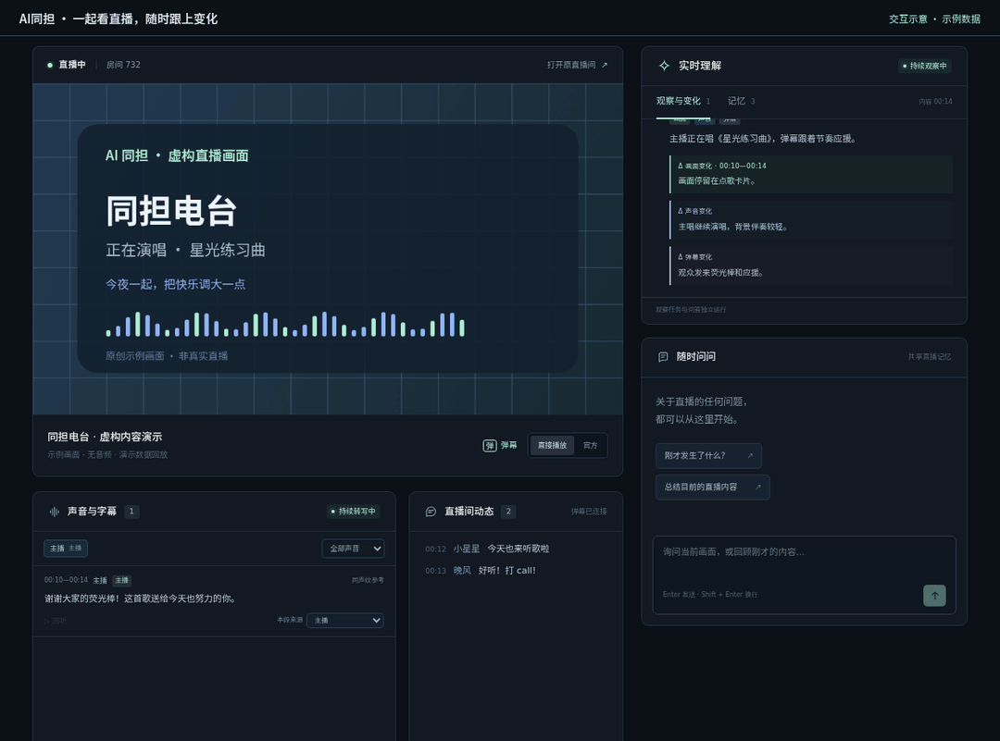
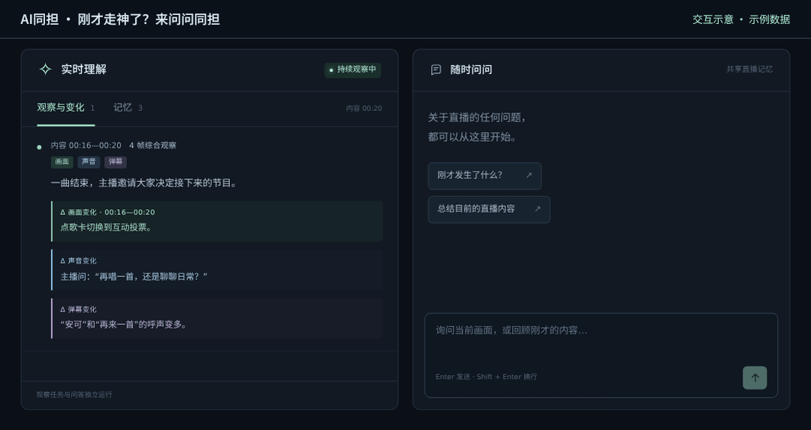
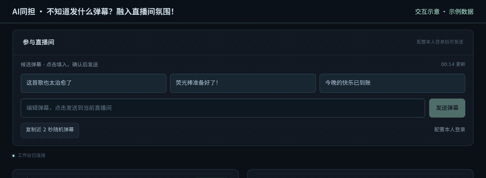

<p align="center">
  
</p>

# AI同担

**你知道吗，你的同担可能是AI。**

一起看直播，一起接梗，一起聊喜欢的人和事。AI同担会结合画面、声音和弹幕记下正在发生的事；你随时可以插一句问题，也可以挑条合拍的弹幕加入现场。

[看看演示](#先看看同担能陪你做什么) · [快速启动](#快速启动) · [详细配置与使用](docs/configuration.md) · [自己部署模型](docs/deployment.md)

维护者：**[BBBBchan](https://github.com/BBBBchan)** · 基于 **[DeltaStreamer](https://github.com/BBBBchan/DeltaStreamer)**（原仓库目前私有，后续开放）· **[CC BY-NC 4.0，禁止商用](LICENSE)**

## 先看看同担能陪你做什么

以下 GIF 使用**真实应用界面与示例数据回放**，直播区域是自制演示画面，用于展示交互方式；不代表实际直播内容、识别准确率或响应速度。GIF 保留录制时的界面，当前版本提供五条候选和“一键融入”控制。[演示说明](docs/assets/README.md)

### 一起看直播 · 前排给你留好啦！

粘贴 Bilibili 直播间地址，就能在同一个页面看直播、追弹幕、读同担的观察。你负责看得开心，同担负责记住“刚才发生了什么”。



### 随时问问 · 刚才走神了？来问问同担发生了什么。

“刚才为什么大家都在笑？”“再说具体一点？”可以连续问、接着问。你们聊天时，同担也会继续观察直播、记录变化。



### 参与直播间 · 不知道发什么弹幕？融入直播间氛围！

同担参考直播内容、画面、声音和最近的弹幕记录，顺着大家的话题更新五条候选，也会记住本轮自己发过的话，减少重复。点一条、改一改，再由你点击发送；“大家在刷”旁的按钮还能一键复制最近 **2 秒**内收到的一条随机弹幕，并填入发送框。

**大家都在刷？这句不能少。** 识别到多人集中复读时，独立的「大家在刷」小区域会展示最多三条原句，不用等模型、不占五条 AI 候选的位置；一键融入也会从中选。向右拉到「开串」，试试假装护航、一本正经说反话的幽默反串。

**接话的语气，也能挑。** “内置风格”下载即用；“本地语料”可加入自己的弹幕或 Super Chat JSON，每轮挑少量例句参考。两种都能拖动“纯良 ↔ 开串”换语气，无需额外训练；个人记录不随仓库分发。[风格与语料说明](docs/configuration.md#两种风格来源内置风格与本地语料)



### 还有这些小默契

| 功能 | 同担想说 |
| --- | --- |
| 在线观看 | **前排座位已就绪。** 在网页看 B 站直播，也可切换官方播放器。 |
| 实时弹幕 | **氛围组集合！** 画面飘过的梗，弹幕列表也帮你接住。 |
| 持续画面观察 | **你眨眼的工夫，我再看看。** 持续记录画面和其中的变化。 |
| 画面、声音与弹幕一起理解 | **光看脸可不够，还得听听大家在说啥。** 观察中结合声音与弹幕，并标明来源。 |
| 多轮问答 | **走神没关系，随时回来接着聊。** 支持提问、追问和取消单个问题，观察仍继续。 |
| 画面回看与音频回听 | **别急，这里还有“刚才那一幕”。** 在保留时间内打开采样画面、回听声音片段。 |
| 音频转写 | **耳朵也跟上啦。** 接入音频服务后，把听到的内容整理成文字；歌声与混音可能听错。 |
| 说话人标记 | **这是谁的声音？你来给同担认认人。** 手动标记主播、背景视频或歌声，支持改名和合并分组。 |
| 记忆同步与恢复 | **这个设定，我记住了。** 声音绑定用于后续问答，正常重启后尝试恢复当前会话。 |
| 弹幕候选 | **想接梗，词穷了？** 根据直播上下文给你五个灵感；拖动“纯良 ↔ 开串”，随时换个语气。 |
| 手动发送弹幕 | **这句话，由你来拍板。** 绑定本人登录后，编辑满意再发送。 |
| 一键融入 | **让同担也聊两句。** 自己设间隔和条数，随机安排下一条；发满条数就收工，不设时限，随时可停。[使用说明](docs/configuration.md#danmaku) |
| 复制近 2 秒随机弹幕 | **快乐可以“+1”。** 抽取一条刚到的新弹幕；没有新消息时会直接告诉你。 |

## 快速启动

第一次接触命令行也没关系：**选自己的系统，逐段复制命令，按回车执行即可。** 下面安装的是网页应用；AI 功能需要接入模型服务，仓库不会自动附送模型或 API 额度。

- **已有兼容模型服务：** 填好地址、模型名和密钥，即可使用观察、问答和候选弹幕。本机无需 GPU。
- **还没有模型服务：** 可以先打开页面、看直播和弹幕；需要 AI 时，按 [模型部署指南](docs/deployment.md) 准备服务。默认视觉模型为 Qwen3.8-27B-FP8，自部署需要合适的 NVIDIA GPU。
- **希望同担也能听懂声音：** 还需 [配置独立音频服务](docs/configuration.md#音频模型)。播放器的直播原声不依赖它。

### 1. 准备工具（只做一次）

需要 Python **3.10 或以上**、FFmpeg，以及帮助下载私有仓库的 Git / GitHub CLI。展开自己系统的说明：

<details>
<summary><strong>Windows：使用 WSL Ubuntu</strong></summary>

在开始菜单搜索 **PowerShell**，右键“以管理员身份运行”，输入：

```powershell
wsl --install
```

按提示重启电脑，从开始菜单打开 **Ubuntu**，首次进入时设置用户名和密码。之后的命令都在 Ubuntu 窗口里执行。具体系统要求与安装问题见 [微软 WSL 安装说明](https://learn.microsoft.com/zh-cn/windows/wsl/install)。

接着执行下方 Linux 的安装命令；后续步骤也继续使用 Ubuntu。原生 Windows 运行尚未完整验证。

</details>

<details>
<summary><strong>Linux / WSL Ubuntu：安装依赖</strong></summary>

在 Ubuntu 22.04 或更新版本的终端中执行：

```bash
sudo apt-get update
sudo apt-get install -y python3 python3-venv python3-pip ffmpeg git gh nano
```

输入系统密码时终端不显示字符，这是正常现象。其他发行版请按 [详细安装说明](docs/configuration.md#安装并启动应用) 准备对应工具。

</details>

<details>
<summary><strong>macOS：安装依赖</strong></summary>

打开“终端”。如果还没有 Homebrew，先按 [Homebrew 官网](https://brew.sh/zh-cn/) 完成安装，并照安装结束时的提示配置终端。然后执行：

```bash
brew install python ffmpeg git gh
```

</details>

执行 `python3 --version`，确认显示 3.10 或更新版本。`ffmpeg -version` 和 `ffprobe -version` 应能显示版本信息。

### 2. 下载 AI同担

仓库目前为私有，需要你的 GitHub 账号已获得访问权限。在终端执行：

```bash
gh auth login --hostname github.com --web
```

按提示在浏览器登录 GitHub、输入终端给出的一次性验证码并授权；若询问 Git 协议，选择 **HTTPS**。浏览器没有自动打开时，手动打开终端显示的网址。这个登录用于下载代码，与 B 站账号是两回事。[GitHub CLI 登录说明](https://cli.github.com/manual/gh_auth_login)

登录完成后执行：

```bash
gh config set git_protocol https --host github.com
gh repo clone BBBBchan/AI-Tongdan
cd AI-Tongdan
```

`cd` 的意思是进入文件夹。**后面的命令都在这个文件夹内执行**，不要每一步都重新打开终端。也可通过网页下载 ZIP，步骤见 [其他下载方式](docs/configuration.md#下载代码)。

### 3. 填好配置

首次安装时执行下面两行；已有 `.env` 就直接编辑，不要再复制覆盖：

```bash
cp .env.example .env
nano .env
```

`.env` 是保存设置的文本文件。使用键盘方向键移动，在文件里找到下面几项，改成**你实际拥有的兼容视觉服务**信息。地址来自服务提供者；不要把 B 站网址填在这里。

```dotenv
MODEL_BASE_URL=http://127.0.0.1:8020/v1
MODEL_NAME=Qwen3.8-27B-FP8
MODEL_API_KEY=替换成你自己的视觉服务密钥
AUDIO_ENABLED=0
```

上面的地址仅适用于**已经在本机启动**的模型服务，复制配置不会启动模型。其他服务要替换地址和实际模型名；API 需支持多图输入等要求，见 [模型接口配置](docs/configuration.md#接入已有模型-api)。暂时只看直播时，保留 `MODEL_BASE_URL` 和 `MODEL_API_KEY` 为空即可。

`AUDIO_ENABLED=0` 表示先关闭后台语音识别，**直播原声仍然可以播放**。已有音频服务时，按 [音频配置](docs/configuration.md#音频模型) 开启并填写其地址和密钥。

编辑完按 **Ctrl+O**，再按 **回车**保存，然后按 **Ctrl+X**退出（Mac 这里也是 Control 键）。后续修改配置后，需要重新启动应用。

### 4. 启动，和同担见面

```bash
bash start.sh
```

第一次运行会自动创建独立的 Python 环境并安装依赖，耗时取决于网络。看到类似 `Uvicorn running on http://127.0.0.1:7862` 后，**保持终端开着**，在同一台电脑的浏览器打开：

**http://127.0.0.1:7862**

粘贴一个正在开播的直播间地址，例如 `https://live.bilibili.com/732`，点击连接。播放器默认静音，想听直播声音时点击音量控件。示例房间不保证一直开播，可以换成你正在看的房间。

已配置视觉模型时，点击右上角的模型状态按钮检查连接；出现观察后试着问：“刚才发生了什么？”想发弹幕，再到“参与直播间 → 配置本人登录”绑定自己的 Cookie：[照着做的绑定教程](docs/configuration.md#绑定自己的-bilibili-cookie)。

停止时在终端按 **Ctrl+C**；下次进入同一个文件夹，再运行 `bash start.sh`。如果上次依赖安装中断，先执行 `.venv/bin/python -m pip install -r requirements.txt`，再启动。远程服务器访问见 [远程部署](docs/configuration.md#远程机器部署与访问)。

## 需要时再翻的小手册

| 想做什么 | 去哪里看 |
| --- | --- |
| 调整模型 API、音频、端口和其他参数 | [详细配置与使用指南](docs/configuration.md) |
| 下载权重、部署视觉与音频模型 | [模型部署指南](docs/deployment.md) |
| 导出、绑定、更新或清除自己的 B 站 Cookie | [本地导出脚本](get_bilibili_cookie.py) · [Cookie 绑定教程](docs/configuration.md#绑定自己的-bilibili-cookie) |
| 标记主播声音、改名或合并说话人 | [声音与记忆](docs/configuration.md#声音说话人和记忆) |
| 备份数据、更新应用、处理运行问题 | [配置指南](docs/configuration.md#数据保存恢复与清理) · [常见问题](docs/configuration.md#常见问题) |
| 使用 Logo 或了解 GIF 录制方式 | [品牌资产](docs/branding.md) · [演示素材](docs/assets/README.md) |

## 来源与许可

**本项目来源于 [DeltaStreamer](https://github.com/BBBBchan/DeltaStreamer)**，在其记忆核心上扩展了直播观看、声音理解、持续问答与弹幕互动。原仓库目前私有，后续计划开放；本仓库已包含运行所需的核心文件，无需另外克隆。来源记录见 [SOURCE_MANIFEST.json](SOURCE_MANIFEST.json)。

原创代码与文档采用 **[CC BY-NC 4.0](LICENSE)，不允许商用**。第三方代码与模型保留各自许可，见 [THIRD_PARTY_NOTICES.md](THIRD_PARTY_NOTICES.md)。

## Citation

如果本项目对你的研究有帮助，请引用其基础工作 **DeltaStreamer**。以下署名与原项目当前论文信息一致；暂未填写尚未核实的 arXiv 编号或 DOI，后续公开后更新。

```bibtex
@misc{sun2026deltastreamer,
  title  = {DeltaStreamer: Towards Human-Like Agentic Streaming Video Understanding},
  author = {Boyuan Sun and Deshui Miao and Wenzhao Gao and Shaoyong Jia and
            Shaohui Jiao and Chi Liu and Yan Shu and Derek Li and Bryan Dai and
            Shengsheng Qian and Qibin Hou},
  year   = {2026}
}
```
