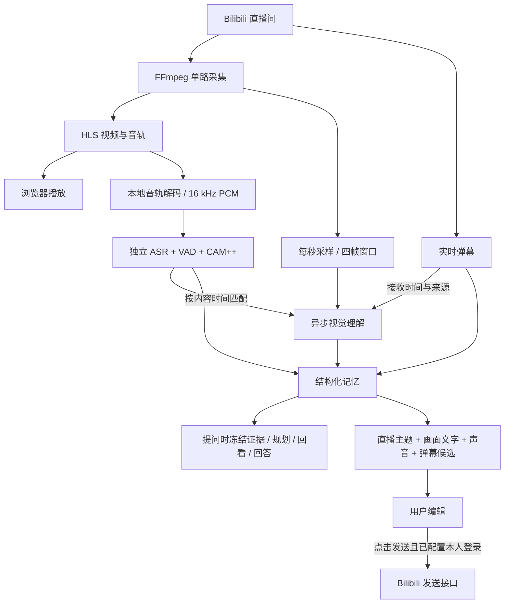

# VTuber-Delta

**面向 VTuber 与 Bilibili 直播的持续理解助手：一边看直播、听声音、读弹幕，一边形成记忆、回答问题并生成互动弹幕。**

项目维护者：**[BBBBchan](https://github.com/BBBBchan)**。

> **项目来源：DeltaStreamer。** VTuber-Delta 基于 [DeltaStreamer](https://github.com/BBBBchan/DeltaStreamer) 的结构化记忆核心，将其扩展为可持续运行的直播应用。**DeltaStreamer 原仓库目前为私有仓库，后续计划开放**；暂无访问权限时，链接显示 404 属于正常情况。本应用已经包含运行所需的三个记忆核心文件，不需要另外克隆原仓库。
>
> 本项目采用 **[CC BY-NC 4.0 — 署名—非商业性使用 4.0 国际](LICENSE)**：**不允许商业用途**。原项目与第三方组件的署名、许可证及来源说明保留在 [THIRD_PARTY_NOTICES.md](THIRD_PARTY_NOTICES.md) 和 [SOURCE_MANIFEST.json](SOURCE_MANIFEST.json)。论文引用见本文最末尾的 [Citation](#citation)。

## 目录

- [功能与使用方式](#功能与使用方式)
- [整体架构](#整体架构)
- [运行条件与部署选择](#运行条件与部署选择)
- [下载代码](#下载代码)
- [安装并启动应用](#安装并启动应用)
- [接入已有模型 API](#接入已有模型-api)
- [自己下载与部署模型](#自己下载与部署模型)
- [远程机器部署与访问](#远程机器部署与访问)
- [绑定自己的 Bilibili Cookie](#绑定自己的-bilibili-cookie)
- [发送弹幕与实时候选](#发送弹幕与实时候选)
- [声音、说话人和记忆](#声音说话人和记忆)
- [内容时间与异步流程](#内容时间与异步流程)
- [配置项参考](#配置项参考)
- [数据保存、恢复与清理](#数据保存恢复与清理)
- [目录结构](#目录结构)
- [测试与验证](#测试与验证)
- [常见问题](#常见问题)
- [来源、许可证与使用范围](#来源许可证与使用范围)
- [Citation](#citation)

## 功能与使用方式

输入 Bilibili 直播间网址，例如 `https://live.bilibili.com/732`，点击连接即可开始。

| 功能 | 当前实现 |
| --- | --- |
| 在线观看 | FFmpeg 转为滚动 HLS，浏览器播放；另提供官方播放器入口 |
| 实时弹幕 | 弹幕叠加、接收列表、连接状态和自动重连 |
| 持续视觉观察 | 每秒采样，默认每次理解连续 4 帧，记录窗口内的变化 |
| 多源变化 | 分别记录画面变化、同期音频转写与观众弹幕，不混淆来源 |
| 连续问答 | 可反复提问、追问和取消单个问题；观察与音频采集始终继续 |
| 可回查证据 | 在保留窗口内打开真实采样帧、回听原始音频片段 |
| 声音理解 | 独立语音模型转写直播音轨，记录来源与时间范围 |
| 说话人参考 | 匿名声纹分组、手工标记来源、改名与合并误拆分组 |
| 记忆同步 | 绑定直接进入声音记忆和后续问答，正常重启恢复活动会话 |
| 弹幕候选 | 根据直播主题、画面及 OCR、音频、其他弹幕生成 3 条候选 |
| 手动发送 | 配置本人登录 Cookie 后，编辑候选或自行输入，再点击发送 |
| 随机复制 | 一键复制浏览器最近 2 秒收到的一条随机弹幕 |

播放器默认静音，点击播放器声音控件即可开启。示例房间只用于演示输入格式，不保证一直开播，也可以更换为其他直播间。

典型提问：

- “刚才发生了什么变化？”
- “分别概括画面、声音和弹幕，说明各自的来源。”
- “最近这段声音说了什么？给我能回听的片段。”
- “刚才提到的那个物体现在在哪里？”
- “我把哪些声音标成了主播参考？”

## 整体架构



应用由三个可分别运行的部分组成：

1. **Web 应用**：FastAPI、静态网页、FFmpeg、直播连接与持续任务；自身不加载大型模型权重。
2. **视觉语言模型服务**：默认使用 `Qwen/Qwen3.8-27B-FP8`，负责四帧理解、问答和弹幕候选；也可以接入兼容服务。
3. **音频服务**：`Qwen3-ASR-0.6B` + Silero VAD + CAM++，负责转写与声纹参考；与视觉服务使用独立进程、依赖环境和接口。

前端无需 Node.js 构建。默认只监听 `127.0.0.1:7862`，使用一个 Uvicorn worker；整个应用共享一个活动直播会话，多个浏览器访问时看到同一房间和记忆。

## 运行条件与部署选择

| 部分 | 条件 |
| --- | --- |
| Web 应用 | Python 3.10 或以上、FFmpeg、ffprobe、可访问 Bilibili 的网络 |
| 浏览器 | 支持现代 JavaScript 和 HLS.js；Chrome/Edge 等现代浏览器均可尝试 |
| 已有模型 API | Web 应用不需要本机 GPU；模型在其他机器运行即可 |
| 自部署视觉模型 | Linux、兼容 CUDA 的 NVIDIA GPU、适合模型与上下文的显存 |
| 自部署音频模型 | 独立 Python 环境；默认 GPU 转写、CPU VAD/声纹，详见部署文档 |
| 远程访问 | 推荐 SSH 本地端口转发；浏览器访问本机转发端口 |

建议先选择一种方式：

- **已有模型服务**：只安装 Web 应用，填写模型接口，最快开始使用。
- **自行部署完整模型**：先启动 Web 应用，再按 [模型部署指南](docs/deployment.md) 下载权重并启动视觉、音频服务。
- **先体验直播页面**：暂不设置模型接口，仍可尝试视频和弹幕；观察与问答会显示等待模型，不会伪造理解结果。

现有视觉部署在 H200 上验证过。FP8 减少权重显存占用，但不同 GPU 对 FP8、上下文长度和并发的支持不同，不能仅按模型参数量判断是否可运行；本项目未对所有显卡做兼容性验证，也不将 FP8 宣称为相对 BF16 的确定加速结论。权重、Python 环境和会话记录均不随 Git 仓库分发。

## 下载代码

本仓库当前为私有仓库，需要先获得访问权限并登录对应 GitHub 账号。**GitHub 登录凭据只用于下载代码，与 Bilibili Cookie 是两回事。**

### 方法一：GitHub CLI

先安装 Git 与 GitHub CLI，然后执行：

```bash
gh auth login
gh repo clone BBBBchan/VTuber-Delta
cd VTuber-Delta
```

`gh auth login` 会引导交互式登录，不需要把访问令牌写入 README、Git remote URL 或应用配置。

### 方法二：SSH

如果 GitHub 账号已配置 SSH key：

```bash
git clone git@github.com:BBBBchan/VTuber-Delta.git
cd VTuber-Delta
```

### 方法三：HTTPS 或 ZIP

```bash
git clone https://github.com/BBBBchan/VTuber-Delta.git
cd VTuber-Delta
```

HTTPS 使用本机 Git 凭据管理器完成认证。也可以在已登录且有权限的浏览器中打开 [仓库首页](https://github.com/BBBBchan/VTuber-Delta)，选择 **Code → Download ZIP**，解压后进入目录。

ZIP 下载适合只运行应用；如果希望后续更新，建议使用 Git。私有仓库无权限时的 404 不表示下载命令有误。

## 安装并启动应用

### 1. 安装 Python 和 FFmpeg

Ubuntu / Debian 示例：

```bash
sudo apt-get update
sudo apt-get install -y python3 python3-venv python3-pip ffmpeg git
python3 --version
ffmpeg -version
ffprobe -version
```

确认 Python 至少为 3.10。系统发行版过旧时，请自行使用合适的新版本 Python 创建环境。

macOS 示例：

```bash
brew install python ffmpeg git
python3 --version
ffmpeg -version
ffprobe -version
```

Windows 建议使用 WSL2 内的 Ubuntu 按 Linux 步骤运行。仓库启动脚本使用 Bash，未对原生 Windows 完整验证。

### 2. 创建独立环境

```bash
python3 -m venv .venv
.venv/bin/python -m pip install --upgrade pip
.venv/bin/python -m pip install -r requirements.txt
```

如果暂时不安装测试和浏览器自动化依赖，只需 `requirements.txt`。视觉模型和音频模型不要装进这个轻量 Web 环境。

### 3. 创建配置文件

```bash
cp .env.example .env
```

编辑 `.env`。最少可以先保留：

```dotenv
FFMPEG_BIN=ffmpeg
DATA_DIR=data
AUDIO_ENABLED=1
SAMPLE_INTERVAL=1
OBSERVATION_FRAMES=4
OBSERVATION_STRIDE=3
OBSERVATION_CONCURRENCY=2
AUDIO_ALIGNMENT_WAIT_SECONDS=4
```

若 FFmpeg 不在 PATH，将 `FFMPEG_BIN` 改为其真实绝对路径；同目录最好有 `ffprobe`，否则需保证 `ffprobe` 可从 PATH 找到。

### 4. 启动

```bash
./start.sh
```

浏览器打开 **http://127.0.0.1:7862**，输入直播间网址并连接。

`start.sh` 在 `.venv` 不存在时也会尝试创建环境、安装应用依赖；首次部署建议手动完成前述步骤，便于发现 Python 或网络问题。

如果希望修改端口：

```bash
HOST=127.0.0.1 PORT=7863 ./start.sh
```

**HOST / PORT 必须通过启动命令的环境变量设置。** 当前 `start.sh` 在应用加载 `.env` 之前确定监听地址，因此仅修改 `.env` 中的 HOST / PORT 不会改变 Uvicorn 监听地址。

### 5. 确认服务状态

```bash
curl http://127.0.0.1:7862/api/health
```

应返回 `ok: true`，并展示 FFmpeg 与模型是否配置。`configured` 仅表示配置存在，**不等于模型已通过实际推理**；页面上的模型检查会执行真实红/蓝双图请求。

## 接入已有模型 API

### 视觉模型

编辑 `.env`：

```dotenv
MODEL_BASE_URL=http://127.0.0.1:8020/v1
MODEL_NAME=Qwen3.8-27B-FP8
MODEL_API_KEY=replace-with-your-own-vision-api-key
MODEL_TIMEOUT=90
```

`MODEL_BASE_URL` 包含 `/v1`。服务需要支持：

- OpenAI-compatible `/chat/completions` 接口；
- 一次输入多张 `image_url` 图片；
- JSON 对象输出；
- 当前适配器使用的 `chat_template_kwargs.enable_thinking=false`。

并非所有“兼容 OpenAI”的服务都支持上述模型参数；接入其他供应商时，可能需要调整 [app/model.py](app/model.py)。默认观察输入 4 张图片，问答最多回看 4 张缓存帧。

### 音频模型

编辑 `.env`：

```dotenv
AUDIO_ENABLED=1
AUDIO_BASE_URL=http://127.0.0.1:8021
AUDIO_API_KEY=replace-with-your-own-audio-api-key
```

音频地址不带 `/v1`。应用将请求 `/analyze`，提交 16 kHz 单声道 WAV 的 Base64，接收带时间、文本与可选声纹的结果。这不是通用的 `/audio/transcriptions` 接口；请使用仓库提供的服务，或实现相同协议。模型下载、接口与验证见 [docs/deployment.md](docs/deployment.md)。

若暂时没有音频服务：

```dotenv
AUDIO_ENABLED=0
```

网页播放的直播原声仍由 HLS 保留；关闭的是后台转写，不是播放器声音。

### endpoint 文件方式

也可以不在 `.env` 写明 API key，而使用本地 endpoint JSON 及独立密钥文件。默认位置：

- `data/model_endpoint.json`
- `data/audio_endpoint.json`

视觉示例：

```json
{
  "base_url": "http://127.0.0.1:8020/v1",
  "model": "Qwen3.8-27B-FP8",
  "api_key_file": "secrets/vision_api_key.txt"
}
```

音频示例：

```json
{
  "base_url": "http://127.0.0.1:8021",
  "model": "Qwen3-ASR-0.6B + CAM++",
  "api_key_file": "secrets/audio_api_key.txt"
}
```

相对 `api_key_file` 路径以 **endpoint 文件所在目录** 为基准。非空 `MODEL_BASE_URL` / `AUDIO_BASE_URL` 优先于对应 endpoint 文件；修改配置后建议正常重启应用，活动会话会尝试恢复。

`.env`、`data/`、密钥和 endpoint 文件均被 `.gitignore` 排除，不应提交到仓库。

## 自己下载与部署模型

完整参数、环境隔离、模型来源与排障见 **[详细部署指南](docs/deployment.md)**。以下是仓库提供的标准入口。

### 1. 下载权重

使用独立下载环境：

```bash
python3 -m venv .venv-download
.venv-download/bin/python -m pip install -r deploy/requirements-download.txt
.venv-download/bin/python deploy/download_models.py --component all
```

只下载视觉或音频组件：

```bash
.venv-download/bin/python deploy/download_models.py --component vision
.venv-download/bin/python deploy/download_models.py --component audio
```

可以先查看下载计划：

```bash
.venv-download/bin/python deploy/download_models.py --component all --dry-run
```

默认下载到 `data/models/`，Git 不追踪该目录。模型下载需要访问相应公开模型托管站点，下载耗时和空间取决于网络及权重大小。模型本身的许可证以其官方模型说明为准。

### 2. 创建本地接口与私有密钥配置

```bash
.venv/bin/python deploy/configure_local.py
```

该命令创建本地 endpoint 配置和密钥文件，不会启动模型，也不会将配置存在等同于推理成功。为保护已有部署，若目标文件已存在会拒绝覆盖；使用自定义目录或先检查现有配置，详见部署指南。

### 3. 分别启动视觉与音频服务

视觉和音频服务使用不同依赖版本，**必须使用独立 Python 环境**。推荐 Linux + Python 3.11，并先确认 NVIDIA 驱动与 CUDA 环境可用。

视觉服务：

```bash
python3.11 -m venv .venv-vision
.venv-vision/bin/python -m pip install -r deploy/vision/requirements.txt
.venv-vision/bin/python -m pip check
.venv-vision/bin/python deploy/vision/serve.py
```

音频服务，另开终端。先按 [部署指南的音频步骤](docs/deployment.md) 为自己的 GPU / 驱动选择兼容的 PyTorch CUDA wheel；下面以 CUDA 12.6 为例：

```bash
python3.11 -m venv .venv-audio
.venv-audio/bin/python -m pip install torch==2.10.0 torchaudio==2.10.0 --index-url https://download.pytorch.org/whl/cu126
.venv-audio/bin/python -m pip install -r deploy/audio/requirements.txt
.venv-audio/bin/python -m pip check
.venv-audio/bin/python deploy/audio/service.py
```

然后再运行 Web 应用：

```bash
./start.sh
```

以上是默认入口；自定义模型位置、GPU、端口、显存与服务参数应按 [docs/deployment.md](docs/deployment.md) 配置。模型可放在不同机器，Web 应用只需能访问接口。

## 远程机器部署与访问

### 推荐：只向本机转发网页端口

在服务器上正常运行 `./start.sh`，在个人电脑终端执行：

```bash
ssh -N -L 7862:127.0.0.1:7862 your-user@your-server
```

个人电脑浏览器访问 `http://127.0.0.1:7862`。这样不需要把带有直播记录、声音参考和发送权限的工作台直接暴露在公网。

### 应用和模型分别位于不同机器

例如 Web 应用在电脑，模型在 GPU 服务器，可转发两个推理端口：

```bash
ssh -N \
  -L 8020:127.0.0.1:8020 \
  -L 8021:127.0.0.1:8021 \
  your-user@your-gpu-server
```

Web 配置仍填写本机 `8020/8021`，同时使用与服务端一致的 API key。模型监听地址、转发目标和认证必须对应。

### 后台运行、停止与更新

可以通过 tmux 等终端会话管理工具保持进程运行：

```bash
tmux new -s vtuber-delta
./start.sh
```

终端内 `Ctrl+C` 正常关闭 Web 服务，保留活动会话恢复指针。网页点击“断开”则主动停止会话并清除恢复指针。

更新代码前先正常停止 Web 服务：

```bash
git pull --ff-only
.venv/bin/python -m pip install -r requirements.txt
./start.sh
```

Web 应用、视觉服务与音频服务是独立进程，停止 Web 不会自动释放模型服务器的 GPU。完整停机时分别关闭对应服务。

若自行设置 `HOST=0.0.0.0` 并通过反向代理访问，需要自行配置 HTTPS、访问鉴权和 SSE 流式代理；当前应用不是多用户隔离平台，多个访问者共享会话与已配置的发送账号。优先使用本地监听加 SSH 转发。

## 绑定自己的 Bilibili Cookie

**观看和接收访客弹幕通常不要求登录；向直播间发送弹幕需要你自己的 Bilibili 登录状态。** Cookie 失效、平台验证、直播间禁言或账号限制仍由 Bilibili 决定。

### 获取本人 Cookie

以 Chrome / Edge 为例：

1. 在自己信任的浏览器打开 [Bilibili 直播](https://live.bilibili.com/)，正常登录本人账号。
2. 打开一个直播间，按 `F12` 打开开发者工具，切换到 **Network / 网络**。
3. 刷新直播间，选中发往 `api.live.bilibili.com` 的正常请求；在 **Request Headers / 请求标头** 找到 `Cookie`。
4. 复制 Cookie 的值，不包含整段请求、不包含 `Authorization`、不复制响应中的 `Set-Cookie`。
5. 确认其中包含 `SESSDATA` 和 `bili_jct`。前者承载登录会话，后者用于发送接口的 CSRF 校验。

也可以在开发者工具 **Application → Cookies** 中查看本人 `bilibili.com` 域下的这两个值，再组成如下格式。下面仅为占位示例，不是可用账号：

```text
SESSDATA=YOUR_OWN_SESSDATA; bili_jct=YOUR_OWN_BILI_JCT
```

不要把 Cookie 放进 Issue、聊天截图、README 或 Git 提交；它不是项目下载所用的 GitHub Token。

### 方式 A：通过网页绑定（适合发送弹幕）

1. 启动应用并连接直播间。
2. 在播放器下方找到 **参与直播间**。
3. 点击 **配置本人登录**，把 Cookie 粘贴到输入框。
4. 点击 **保存登录**。输入框会立即清空，页面只展示是否已配置。
5. 选择候选弹幕或自行输入文本，再点击 **发送弹幕**。

Cookie 保存在本机 `data/bilibili_send_credentials.private.json`，权限为 `0600`；如果更改了 DATA_DIR，则保存在对应数据目录。它不会返回在 `/api/state` 中，不会被送给模型。页面保存只做格式检查，真正发送前会向 Bilibili 核实登录状态，因此“已配置”不等于 Cookie 永不过期。

修改账号时，重新保存本人新 Cookie 即可。本地保存值优先于 `.env` 的 BILIBILI_COOKIE。

### 方式 B：通过 `.env` 绑定

编辑 `.env`：

```dotenv
BILIBILI_COOKIE="SESSDATA=YOUR_OWN_SESSDATA; bili_jct=YOUR_OWN_BILI_JCT"
```

然后正常重启应用。此方式同时可供直播平台连接使用；如果平台要求登录后接收弹幕，优先使用此配置。

网页保存的发送 Cookie **不会自动替换当前接收连接**的 Cookie。只为发送设置登录时用方式 A；接收连接需要登录时用方式 B 并重启。

### 清除或更新绑定

重新保存会替换本地发送账号。也可以在本机清除网页保存的配置：

```bash
curl -X POST http://127.0.0.1:7862/api/danmaku/credentials \
  -H 'Content-Type: application/json' \
  --data '{"cookie":""}'
```

该操作只删除本地 Cookie 文件；如果 `.env` 仍有 BILIBILI_COOKIE，会回退使用环境配置。要完全取消绑定，需要同时清空 `.env` 的该项并重启。

发送被拒绝时查看页面提示：过期则更新 Cookie；需要验证码时回到官方直播间完成验证；禁言、频率限制等需按平台规定处理。程序不会绕过限制，也不会在超时后自动重发。

## 发送弹幕与实时候选

### 三条候选如何生成

候选生成会综合最近的：

- 直播主题与房间标题；
- 四帧画面理解、动作变化与画面 OCR；
- 带源时间和不确定性标记的声音转写；
- 其他观众发送的弹幕。

默认约每 **12 秒**尝试更新一轮，具体还受模型耗时影响。输入使用有界的近期内容，某路暂时不可用时，只依据仍有效的来源生成，不编造缺失证据。观众说法与自动转写不会被当成无误事实。

候选更新不会覆盖手写草稿。**点击候选只是填入输入框，只有点击“发送弹幕”才会真正调用发送接口。** 可以先编辑，再决定是否发送。

### 发送规则

- 当前默认限制 20 个 UTF-16 单元，普通汉字通常计 1，部分 Emoji 计 2。
- 请求携带当前会话 ID；切换房间后旧页面请求会被拒绝，避免误发到新房间。
- 成功提示“Bilibili 已受理发送请求”不保证平台一定展示这条弹幕。
- 发送请求不自动重试；超时可能意味着结果未知，应先在直播间确认。
- 使用本人的登录账号，程序不提供匿名发送或自动刷屏。

### 复制最近 2 秒的随机弹幕

点击 **复制近 2 秒随机弹幕** 后，程序从浏览器最近两秒实际收到的新弹幕中随机抽取一条并复制。

- 刷新页面加载的历史列表不算“刚收到”。
- 两秒内没有新弹幕时，显示提示，不用旧弹幕代替。
- 只执行复制，不自动填入发送框或发送。
- 浏览器不允许自动写入剪贴板时，会展示已选中文本，按 `Ctrl+C` / `Command+C` 手动复制。

## 声音、说话人和记忆

### 声音链路

后台复用已经完成的本地 HLS 分片提取 16 kHz 单声道 PCM，默认约 4 秒形成一个音频块，再进行 VAD、转写和声纹处理。声音队列最多保留两个待处理块，拥堵时优先跟上最新直播，不阻塞视频。

这是连续音频短块的异步转写，当前没有逐字临时字幕，也没有逐词强制对齐。唱歌、混音、背景视频、跨块句子都可能导致漏字或错字。用户可回听原始片段核实。

### 说话人分组

声纹以“说话人 A/B/…”匿名分组，不能证明真实身份或音源来自实时麦克风。

- 新声音需要至少两段一致有效声纹才确认，并回填首段。
- 已确认组保留有限多个参考，允许一定声音变化，弱匹配保留不确定标记。
- 短片段、混杂或模糊匹配仍可能显示“待定”。
- 当前最多保留 16 个说话人组；阈值为启发式，并非校准后的身份概率。
- 系统不会自动把第一个、最响或出现最多的声音认成主播。

### 绑定、改名与合并

声音面板中的来源可标为“主播 / 背景视频 / 歌声 / 来源不确定”：

1. **单段标记**只影响该片段，优先于说话人组的来源参考。
2. **说话人绑定**作为同声纹来源参考，立即进入记忆页和后续问答。
3. **改名**方便区分多个声音；不会修改实际身份事实。
4. **合并**用于人工确认的误拆分组，保留目标名称与单段人工标记。
5. 两个明确来源标签冲突时，需先调整标签再合并；不会因为两组都标“主播”就自动合并。

已提交的问题保留提交时的标记快照，后续绑定不会悄悄改写旧回答。声音参考和标签会在正常重启后恢复。

当前没有可靠的自动混音分离、歌曲分类或重叠说话检测。主播自己的录音和实时说话也可能得到同一声纹组；真正区分音源通常需要独立音轨或其他可靠证据。

## 内容时间与异步流程

### 四帧理解

默认 `SAMPLE_INTERVAL=1`，四帧覆盖约 3 秒的采样窗口；每新增 3 帧提交下一窗口，邻近窗口共享一帧。两个理解请求可并发，另保留一个待处理窗口。

积压时替换尚未启动的旧窗口，优先跟上最新内容；较新结果先完成时不等待旧结果，之后返回的旧结果不会倒写最新视觉记忆。

### 音频与理解时间一致

音频和采样帧使用同一代媒体连接的会话时间轴。视觉窗口只参考与其源时间重叠的音频，弹幕按接收时间匹配：

- 最多后台等待 `AUDIO_ALIGNMENT_WAIT_SECONDS=4` 秒，让同期转写到达；
- 静音音频也计入已完成覆盖，失败区间不被伪装为完整；
- 超时继续视觉理解，并展示“同期音频待到”或部分到达；
- 晚到音频按**原内容时间**补记，处理时间单独记录；
- 观察卡片、声音面板与记忆显示对应内容区间，按源时间排列。

直播播放不等待理解结果，因此不会为了同步文字而额外延后播放器。媒体锚点仍受初始接收、CDN 和采样网格影响，默认约有半个采样间隔的不确定性；这不是绝对开播时钟或逐词时间。

### 提问不会停止持续观察

每次提问冻结当时可用的画面、记忆、弹幕、声音和说话人档案。最多四个待处理问题逐个回答，视觉观察和音频采集继续独立运行；回答结束后也不会停止 Delta 记录。

问答流程为一次结构化规划、检索记忆、回看最多四张真实缓存帧，再生成回答。取消某个问题只释放该问题持有的帧引用。

### 延迟怎么看

`inference_seconds` 为模型请求耗时；`completion_lag` 为窗口最后一帧接收到结果生成的耗时，含有限排队和同期音频等待，不含直播源已有的 CDN 延迟。

所有耗时都受采样、网络、模型负载、GPU 与上下文影响。测试中的某次回答耗时不能视作稳定吞吐保证。

## 配置项参考

| 配置 | 默认值 / 含义 |
| --- | --- |
| MODEL_BASE_URL | 视觉服务地址，例 `http://127.0.0.1:8020/v1`；非空时优先 |
| MODEL_NAME | `Qwen3.8-27B-FP8`，须与模型服务暴露的名称一致 |
| MODEL_API_KEY | 视觉 API key；不要提交 |
| MODEL_ENDPOINT_FILE | 默认 `data/model_endpoint.json` |
| MODEL_TIMEOUT | 90 秒，视觉服务请求超时 |
| AUDIO_ENABLED | `1`；设为 `0` 停止后台转写 |
| AUDIO_BASE_URL | 音频服务地址，例 `http://127.0.0.1:8021` |
| AUDIO_API_KEY | 音频服务 API key |
| AUDIO_ENDPOINT_FILE | 默认 `data/audio_endpoint.json` |
| AUDIO_ALIGNMENT_WAIT_SECONDS | 4 秒，允许 0–8；不延迟播放器 |
| FFMPEG_BIN | `ffmpeg`，也可设绝对路径 |
| SAMPLE_INTERVAL | 1 秒，最小 0.5 秒 |
| OBSERVATION_FRAMES | 4；也支持 2 帧基线 |
| OBSERVATION_STRIDE | 3 个采样帧，允许 1–4 |
| OBSERVATION_CONCURRENCY | 2，最大为 2 |
| ROOM_POLL_SECONDS | 20 秒，房间开播状态轮询间隔 |
| DATA_DIR | `data`，相对路径以项目根目录为基准 |
| BILIBILI_COOKIE | 可选，本人登录 Cookie |
| HOST / PORT | 启动命令环境变量，默认 `127.0.0.1 / 7862` |

模型启动器另有 GPU、模型路径、端口及密钥文件环境变量，见 [部署指南](docs/deployment.md)。

## 数据保存、恢复与清理

默认数据目录示意：

```text
data/
├── active_session.json
├── model_endpoint.json
├── audio_endpoint.json
├── bilibili_send_credentials.private.json
├── secrets/
├── models/
└── sessions/<session_id>/
    ├── session.json
    ├── events.jsonl
    ├── media/gN/                    # 滚动 HLS 缓存
    ├── agent/state.json             # 文字观察、记忆与对话
    ├── agent/frames/                # 有界采样帧缓存
    ├── audio/state.json             # 音频文字和公开标签
    ├── audio/state.private.json     # 声纹参考，0600
    └── audio/*.wav                  # 原始片段回听
```

### 默认保留范围

| 内容 | 有界保留 |
| --- | --- |
| 采样帧 | 最近 300 张；待处理问题/观察可临时保护额外帧 |
| 观察记录 | 最近 400 条，前端渲染最近部分 |
| 片段摘要 | 最多 80 个 |
| 重要事实 | 最多 40 条 |
| 对话 | 最多 80 条消息 |
| 音频证据 | 最多 200 段 WAV 与对应文字 |
| 声音参考 | 最多 16 组，参考向量单独私有保存 |
| HLS | 滚动分片和最多两代连接目录 |
| 事件日志 | 约 10 MiB 轮转，当前文件与四个备份 |

正常关闭进程后重启，会尝试恢复原活动房间、文字记忆、已完成对话、声音记录和手工绑定。进行中的问题不会续跑，旧采样帧缓存可能过期；已过期证据返回 HTTP 410，文字仍可保留。

网页点击“断开”会清除活动恢复指针。不同历史会话目录不会自动全部删除；应用不是完整录像系统，也不是无限归档系统。

如需迁移，请在正常停止 Web 服务后备份 DATA_DIR；其中包含本人 Cookie、音频、声纹参考和直播记录，应仅存放在自己信任的位置。模型权重较大，可分开备份或重新下载。

清理旧会话时先确认其 ID 并停止相关会话，删除对应 `data/sessions/<id>/` 目录；不要在运行中删除当前会话数据。删除整个 data 还会移除模型配置、登录信息及下载的权重。

## 目录结构

```text
VTuber-Delta/
├── app/                        # 直播接入、任务调度、问答、音频与发送接口
├── static/                     # 无需构建的 Web UI 与 HLS.js
├── vendor/deltastreamer/        # 原项目记忆核心与许可证
├── deploy/
│   ├── download_models.py      # 固定来源的权重下载入口
│   ├── configure_local.py      # 本地密钥与 endpoint 初始化
│   ├── vision/                 # 独立视觉模型启动器
│   └── audio/                  # 独立 ASR/VAD/CAM++ 服务
├── docs/deployment.md           # 详细模型部署说明
├── tests/                      # 自动化回归与真实模型验证入口
├── .env.example                # 不含凭据的配置模板
├── start.sh                    # 单 worker Web 启动入口
├── requirements.txt
├── requirements-dev.txt
├── SOURCE_MANIFEST.json         # DeltaStreamer 来源、commit 与 SHA256
├── THIRD_PARTY_NOTICES.md
├── CITATION.cff
└── LICENSE
```

本仓库不包含开发机器的调度器、内部 IP、既有 GPU 任务配置、运行环境、模型权重、Cookie、声纹向量或历史直播记录。`deploy/` 是可迁移的启动入口。

## 测试与验证

安装开发依赖并执行应用回归：

```bash
.venv/bin/python -m pip install -r requirements-dev.txt
.venv/bin/python -m pytest -q
```

本次发布检查中，开发工作区和不带本机配置的干净代码副本均通过全部 **130 项应用测试**；干净副本仅通过 FFMPEG_BIN 指定已安装的 FFmpeg，没有复制 Cookie、模型 endpoint 或其他私有配置。测试覆盖：

- Bilibili URL、弹幕协议、压缩边界和生命周期；
- 四帧调度、乱序结果、有限队列和帧引用保留；
- 连续问答、取消、提交瞬间快照及中文检索；
- 音轨提取、ASR 超时、失败恢复和声纹/标签优先级；
- 音频源时间对齐、静音覆盖、迟到补记与恢复迁移；
- 候选弹幕的多源输入、长度、去重及不可信内容处理；
- Cookie 保存、会话隔离、发送错误和不自动重发。

部分媒体测试依赖本机 FFmpeg，缺失时可能被跳过；请查看测试输出，而非仅依据命令退出成功判断覆盖完整。

真实模型验证：

```bash
.venv/bin/python tests/validate_live_agent.py --help
.venv/bin/python tests/validate_live_agent.py
```

该脚本使用合成场景调用已配置的真实视觉服务；需要 endpoint JSON 和实际可用模型，不把合成测试画面当作直播。结果写入本地 `test-results/`，该目录不提交。

开发过程中还进行过真实直播浏览器验证：视频、音频、弹幕、反复问答、音频时间对应、候选更新与近两秒复制均已跑通。发送 API 的自动化和浏览器发送测试使用模拟接口，**没有向真实直播间发送测试消息**；实际发送需使用部署者本人有效账号。

新增可迁移模型启动脚本经过何种检查，以及哪些 GPU 部署步骤仍需在目标机器验证，以 [docs/deployment.md](docs/deployment.md) 的验证范围说明为准。

## 常见问题

### 页面能打开，但模型没有输出

检查 `/api/health` 中的 configured，再执行页面模型检查。确认服务地址能从 **Web 应用所在机器** 访问，视觉地址带 `/v1`，模型名称、API key 与服务端一致。

configured=true 只代表填了配置。服务尚未加载完权重、GPU 显存不足、接口不支持多图/JSON 或 key 错误都可能导致推理失败。

### 配好了 `.env`，为什么还是访问旧服务？

非空 BASE_URL 优先于 endpoint JSON；应用进程的既有环境变量又可能优先于 `.env`。检查启动终端环境和两套配置，正常重启后重新确认。

### 无法播放，或者只有官方播放器能看

检查 FFmpeg、直播是否开播、服务器网络与平台连接提示。官方播放器能播放不代表后台 FFmpeg 采样成功；后台失败时不会生成虚假的观察。Bilibili 播放地址和接口可能变化，服务会退避重连。

### 能听到直播声音，但没有文字转写

播放器原声和后台转写是两条不同链路。确认 AUDIO_ENABLED、音频服务 `/analyze`、ffprobe、音轨存在状态及声音面板错误。音频服务离线不应阻止画面观察。

### 音频文字为什么仍有延迟？

需要累积音频块、等待 HLS 分片完成、执行转写和理解。页面按原内容时间归位，但不会把后台处理变成零延迟；播放器保持低延迟继续播放。

### 唱歌、音乐背景或多人同时说话识别不准怎么办？

当前短块 VAD/ASR 和声纹不是混音分离系统。优先回听原片段，手工标记来源；不要把歌声或混杂音频当成稳定身份参考。此版本未实现专门的歌声识别模式。

### 绑定主播后，为什么旧回答没有改变？

已提交的问题使用冻结快照，已完成回答保留当时证据。绑定会立即更新记忆并用于新问题；这是避免回答在后台无提示变化的设计。

### 为什么有“同期音频待到”？

视觉窗口对应的 ASR 尚未完成且有限等待已结束。程序继续理解画面，稍后按原时间记录声音，不使用前一段声音代替。

### 声纹经常出现待定，或者同一声音被拆成多组？

短语音、歌声、音色变化和混音都可能导致不确定。可选择清晰单人片段作为来源参考；人工确认误拆后在说话人编辑窗口合并。分组减少不等于身份准确率必然提高。

### Cookie 保存了，为什么无法发送？

保存只检查格式。确认是本人 Bilibili Cookie，至少包含 SESSDATA 和 bili_jct，并检查是否过期、需要验证、被禁言或触发频率限制。平台限制不能通过应用配置绕过。

### 随机复制为什么提示没有弹幕？

它严格只选浏览器刚收到的两秒内新弹幕；连接后加载的历史弹幕、较早弹幕和恢复状态均不会用来凑数。

### 历史证据为什么返回 410？

采样图和 WAV 有保留上限，正常重启也可能清理未注册的旧帧缓存。文字保留不保证音视频证据永久可用。

### 可以同时给多个用户分别看不同房间吗？

当前工作台只有一个共享活动会话。需要隔离房间时运行独立实例，并为每个实例设置不同的 DATA_DIR 和 PORT；不要增加 Uvicorn worker 数量来模拟多用户隔离。

## 来源、许可证与使用范围

### 与 DeltaStreamer 的关系

原始项目：**[DeltaStreamer](https://github.com/BBBBchan/DeltaStreamer)**，目前私有，后续计划开放。

本仓库从其提交 `b60625d8f14f7622c504b642178ec8be07a00e4d` 复制以下三个记忆核心文件，并保持其内容不变：

- `core/tools/base.py` → `vendor/deltastreamer/base.py`
- `core/tools/memory.py` → `vendor/deltastreamer/memory.py`
- `core/tools/memory_graph.py` → `vendor/deltastreamer/memory_graph.py`

具体 SHA256 与来源见 [SOURCE_MANIFEST.json](SOURCE_MANIFEST.json)。直播平台接入、异步调度、媒体链路、独立音频服务、问答适配、网页及弹幕功能在本仓库实现。VTuber-Delta 是基于原工作扩展的直播应用，不等同于原论文的完整评测管线。

### 非商业许可证

本项目原创代码与文档采用 **CC BY-NC 4.0**，即 Creative Commons Attribution-NonCommercial 4.0 International。使用、分享或修改时需遵守署名和非商业条件，并保留许可证及变更说明。

**不允许将本项目用于商业用途。** 完整授权条件以 [LICENSE](LICENSE) 和 [官方许可证](https://creativecommons.org/licenses/by-nc/4.0/) 为准。

DeltaStreamer 原核心保留其许可证；HLS.js、CAM++ 等第三方代码保留自己的许可证，不能用本项目声明替换它们的原授权。下载的模型权重和安装的依赖也有各自许可证，详见 [THIRD_PARTY_NOTICES.md](THIRD_PARTY_NOTICES.md)。本项目许可不授予直播内容、音乐或他人账号的权利。

## Citation

如果本项目对你的研究有帮助，请引用其基础工作 **DeltaStreamer**。以下署名与原项目当前论文信息一致；暂未填写尚未核实的 arXiv 编号或 DOI，后续公开后更新。

```bibtex
@misc{sun2026deltastreamer,
  title  = {DeltaStreamer: Towards Human-Like Agentic Streaming Video Understanding},
  author = {Boyuan Sun and Deshui Miao and Wenzhao Gao and Shaoyong Jia and
            Shaohui Jiao and Chi Liu and Yan Shu and Derek Li and Bryan Dai and
            Shengsheng Qian and Qibin Hou},
  year   = {2026}
}
```
